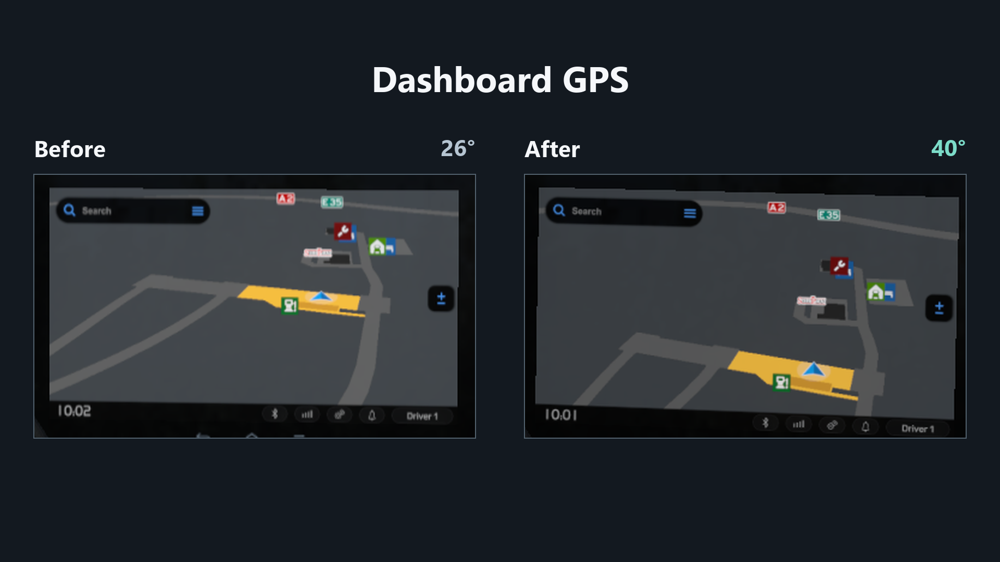

# [ETS2 Mod] Better GPS Pitch

Matches the dashboard GPS 3D camera pitch to the stock HUD minimap's 40° pitch and places the vehicle marker about 20% up from the bottom of the map in Euro Truck Simulator 2 1.62.

## In-game comparison

Both dashboard GPS captures show a parked Volvo FH 2024 at the same location in Rotterdam in ETS2 1.62.3.3. The measured 3D pitch is **26°** before and **40°** after enabling the mod.



## Installation

Copy `ets2-better-gps-pitch.scs` into `Documents/Euro Truck Simulator 2/mod`, enable **Better GPS Pitch** in Mod Manager, and select a 3D view on the dashboard GPS.

## Camera pitch and compatibility

ETS2 1.62.3.3 uses the pitch from `def/map_data.sii` for the HUD and multiplies it by 0.65 for the dashboard GPS. Setting `map_3d_camera_pitch` to `61.538464` yields 40° on the dashboard and about 61.54° on the HUD while this mod is active. Each screen has its own framing and zoom.

The marker position applies to the built-in truck and coach GPS layouts in both 3D and 2D views of the dashboard map.

This mod replaces `def/map_data.sii` and the stock GPS layouts. Map overhauls and dashboard mods such as **Dashboard GPS Speed and Limit** can override the same files.

## Development

Install the [shared build dependencies](../../README.md#local-builds), then build `mods/better-gps-pitch/build/ets2-better-gps-pitch.scs` from the repository root.

```powershell
python scripts/build.py mods/better-gps-pitch
```

Add a Workshop preview as `icon.jpg` in this mod directory before building its Workshop ZIP. See the [shared build and release guide](../../README.md) for packaging and tag instructions.

Original contributions are licensed under the [GNU General Public License v3.0](LICENSE).
