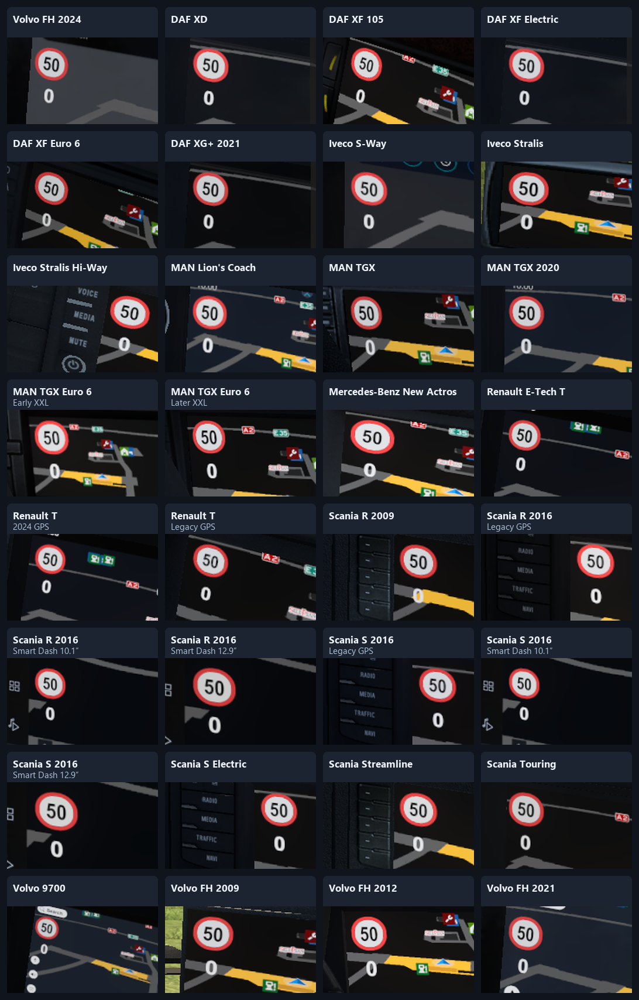

# [ETS2 Mod] Dashboard GPS Speed and Limit

Adds a speed limit sign and current speed to the dashboard GPS in all SCS trucks and coaches.

Original contributions are licensed under the [GNU General Public License v3.0](LICENSE).

## Installation

Subscribe the official [steam workshop](https://steamcommunity.com/sharedfiles/filedetails/?id=3841119859) item.

## Compatibility

The mod may conflict with mods that modify the cluster or dashboard.

## Screenshots

See full list of screenshots [here](screenshots/README.md).



## Development

Run these commands from the repository root. See the [shared build and release guide](../../README.md) for Workshop packaging and release tags.

```powershell
python scripts/build.py mods/dashboard-gps-speed
```

### Rebuild screenshot preview

On `main`, [Actions](https://github.com/namu-lee/ets2-mods/actions/workflows/preview.yml) rebuilds and commits the preview PNG when its inputs change.

```powershell
python -m pip install numpy pillow
python mods/dashboard-gps-speed/build_preview.py
```

### Indicator size and position

#### 1. Size

Measure at native 2560×1440 using each vehicle’s default FOV and default left-hand-drive cab view (`1`). Aim for **17–18 px for the limit and 16 px for current speed**. Reuse those scales on right-hand-drive cabs.

Set `xscale = yscale` for current speed and `xscale = 0.8 × yscale` for the limit so three digits fit inside the ring. [Text templates](src/ui/template/dashboard_text.gps_speed.sii)

**Exception.** Use the largest size that fits when the target size would clip or overlap controls.

- Volvo 9700 (11–12 px limit, 11 px current speed)

#### 2. Position

Stack the displays at the map’s upper left, just below any controls in that corner. Check both steering sides for overlap and clipping.

**Exception.** Center the stack vertically in the gap when the left column has controls above and below it.

- Scania R/S Smart Dash (10.1″ and 12.9″)
- Volvo FH 2021
- Volvo 9700
